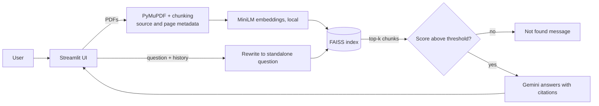

# Multi-Document RAG with Conversational Memory

Upload multiple PDFs, ask questions in natural language, and get answers grounded in the documents
with source references. Follow-up questions work because each question is rewritten using chat history.

## Architecture


## How it works
1. PDFs are split page by page into chunks (800 characters, 150 overlap); each chunk keeps `source` and `page`.
2. Chunks are embedded locally with `all-MiniLM-L6-v2` and stored in FAISS (cosine similarity).
3. A follow-up question is rewritten into a standalone question using the last 6 turns.
4. The top 5 chunks are retrieved (top 10 for comparison questions).
5. If the best similarity is below the threshold, the app replies that the information was not found.
6. Otherwise Gemini answers using only the retrieved context and cites `[file, p.N]`.

## Tech stack
Python, Streamlit, PyMuPDF, LangChain text splitters, sentence-transformers, FAISS, Google Gemini.

## Setup
```bash
git clone https://github.com/Diya27Garg/multi-doc-rag.git
cd multi-doc-rag
python -m venv .venv
.venv\Scripts\activate          # Mac/Linux: source .venv/bin/activate
pip install -r requirements.txt
copy .env.example .env          # Mac/Linux: cp .env.example .env
# add your GEMINI_API_KEY to .env
streamlit run app/streamlit_app.py
```
Then upload the PDFs from `data/sample_docs/`, click **Process documents**, and start asking questions.

## Sample documents
`data/sample_docs/` contains four **synthetic** PDFs generated for testing (no real company data):
NovaTech annual reports for FY2023 and FY2024, a BrightWave FY2024 annual report, and a NovaTech
remote-work and data-security policy.

## Testing
| Test | Question | Result | Correct |
|---|---|---|---|
| Direct | What was NovaTech's net profit in FY2024? | Rs 745 crore [NovaTech_Annual_Report_FY2024.pdf, p.3] | Yes |
| Follow-up | ...and in the previous year? | Rewritten to FY2023; Rs 612 crore | Yes |
| [fill in] | | | |

Screenshots: `screenshots/`

## Limitations
- Scanned PDFs are not supported (no OCR).
- Tables are extracted as plain text and may lose structure.
- The index is in memory and is rebuilt each session.
- The similarity threshold (0.25) was set by hand and may need tuning for other documents.

## Future work
LangGraph flow with a verification step, FastAPI backend, Docker, persistent index, reranking, OCR,
and an open-source LLM option via Ollama.